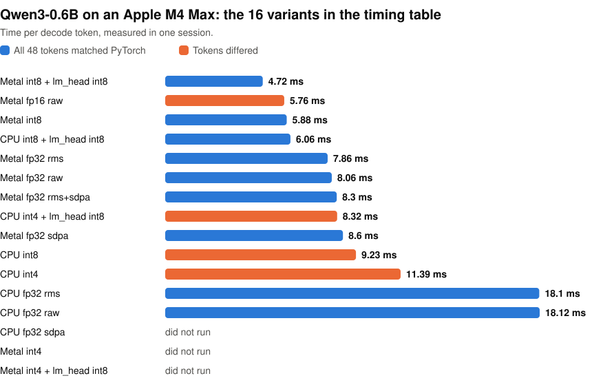

# Tensor API bring-up harness

The [LiteRT Tensor API](https://github.com/google-ai-edge/LiteRT/tree/main/tensor) lets you write a model's graph directly in C++ instead of converting it. This repo is a checklist and check scripts for handing that work to your own coding agent. The agent writes the graph, and every row of the checklist leaves a file showing what happened.

<p align="center">
<picture>
  <source media="(prefers-color-scheme: dark)" srcset="https://raw.githubusercontent.com/john-rocky/tensor-api-harness/main/docs/images/forms-dark.svg">
  
</picture>
</p>

A coding agent took [Qwen3-0.6B](models/qwen3-0.6b/) through all 15 rows in six iterations. Of the 16 variants in its timing table, timed in one session on an Apple M4 Max, 9 gave the same 48 tokens as PyTorch. The fastest of those was Metal with int8 weights and an int8 lm_head, at 4.72 ms per token, against 18.12 ms for CPU fp32. In the chart, `rms` and `sdpa` use LiteRT's composite ops for RMSNorm and attention, and `raw` builds them from plain ops.

On a Galaxy S26, the graph with int8 weights took 26.7 ms per token on the GPU through OpenCL. On the CPU, with an int8 lm_head as well, it took 13.0 ms. Inside LiteRT-LM on the Mac, it decoded faster than the published `.litertlm` on the CPU and slower on the GPU, and it used more memory ([the numbers](docs/inside-litert-lm.md)).

## What the table looks like

Each row says what to do and what counts as a pass. The agent fills in a status and the file that shows the result. These are two rows of the filled table, without its column on how to do each row:

| # | Row | Pass when | Status | Evidence |
|---|---|---|---|---|
| 4 | Weight loading | Every graph weight has a source tensor; the name map and a shape table are in the evidence. | tried | `results/weights_map.md`, `graph/qwen3_weights.cc` |
| 6 | Output text match | `checks/text_match.py` passes: every id equal. | tried | `results/text_match.txt`, `results/text_graph.txt`, `reference/ref_ids.json` |

`tried` says the agent made the attempt and saved the result, and the result file says whether it passed. A row can also end as `not applicable` or `blocked`. [`tools/done_check.py`](tools/done_check.py) refuses "done" while a row is `not yet`, or while a `tried` row has no evidence file that exists. The scripts in [`checks/`](checks/) compare the outputs.

See [the blank table](skill_table.md) and [the filled one](models/qwen3-0.6b/skill_table.md).

## Run it on one model

You need a LiteRT checkout, Bazel through bazelisk, Python 3 with numpy (torch and transformers for the reference dumps), and the model's checkpoint from Hugging Face.

1. Clone this repo and copy the table:

   ```bash
   git clone https://github.com/john-rocky/tensor-api-harness
   cd tensor-api-harness
   mkdir -p models/<name>/iterations
   cp skill_table.md models/<name>/skill_table.md
   ```

2. Write `models/<name>/iterations/ITERATION_1.md` from `iterations/ITERATION_TEMPLATE.md`. Fill in which rows this iteration covers, how close the output must be to the reference, and the device.
3. Give that file to the coding agent as its instruction. I use Claude Code, but the files are plain text for any agent.
4. Run `python3 tools/done_check.py models/<name>/skill_table.md`. It lists the rows still `not yet`, and the next iteration starts from them. A `blocked` row comes with its cause for you to act on.
5. Repeat 3 and 4 until it prints `DONE`.

To build a graph, `tools/overlay.sh <LiteRT checkout> <name>` links it into your LiteRT checkout and prints the commands to build and run it.

## Documentation

- [What each file does](docs/files.md)
- [Writing the graph code](docs/graph-code.md)
- [Qwen3-0.6B, row by row](docs/qwen3-0.6b.md): output match, accelerators, quantization, the phone runs and the hours spent
- [Running the graph inside LiteRT-LM](docs/inside-litert-lm.md)
- [Environment](docs/environment.md): the commits, toolchains and devices

## License

Apache 2.0.
